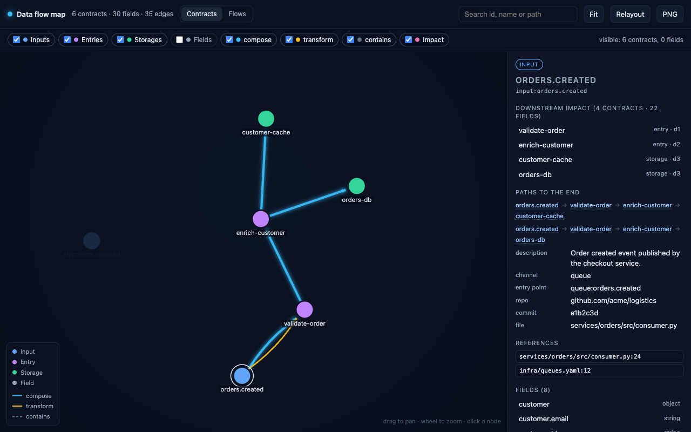
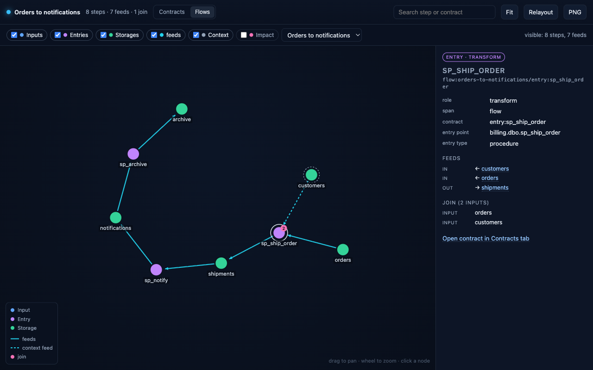

# logistic-map

A portable agent skill that treats application data flow as a **logistics
process**: inputs are cargo arriving, entries are the intermediate shapes cargo
takes inside the application, storages are warehouses, fields are the cargo
manifest, and procedures are where cargo is merged (a join) or split.

It keeps a [LadybugDB](https://github.com/LadybugDB/ladybug) graph of those **data entities** and
answers the questions a contract review usually misses:

- Which input does this field come from, and what changes it on the way?
- Which fields does the producer send that the consumer never reads?
- Where does a type disagree between two contracts?
- What does an input affect downstream, and by which paths?

It records **EntryPoint** activations (routes, consumers, jobs, UI actions),
**Input** data contracts, **Entry** intermediate entities (validated, normalized
or enriched payloads), **Storage** locations, **External System** dependencies
(SMS, payment, shipping APIs) and the **Field** tree of each entity. A CLI writes
the graph and produces reports; `render` turns it into a standalone **logistic
map** where entrypoints, flows, entities and external systems share a single
interactive view.

Everything runs on plain Python plus a static HTML file: no server, no cloud
service, no harness-specific runtime.



## Requirements

- Python 3.10 or newer
- Bash (macOS or Linux)
- No global installs: `scripts/bootstrap.sh` creates a project-local venv and
  installs LadybugDB (`ladybug>=0.22,<0.23`) with pip.

## Install

A skill is a directory containing `SKILL.md` plus optional resources. Clone this
repository wherever your harness looks for skills:

```sh
mkdir -p .agents/skills
git clone git@github.com:homealoneai/skill-logistic-map.git .agents/skills/logistic-map
```

The directory must be named `logistic-map`, matching the `name` in `SKILL.md`.

Common skill directories:

| Scope | Directory |
|---|---|
| Shared, project | `.agents/skills/` |
| Shared, user | `~/.agents/skills/` |
| Claude Code, project | `.claude/skills/` |
| Claude Code, user | `~/.claude/skills/` |

Other harnesses use their own directory; the requirement is that the harness
discovers `SKILL.md` inside a directory named `logistic-map`. Keeping the
checkout elsewhere and symlinking it works too:

```sh
git clone git@github.com:homealoneai/skill-logistic-map.git ~/src/logistic-map
mkdir -p ~/.agents/skills
ln -s ~/src/logistic-map ~/.agents/skills/logistic-map
```

Any harness that follows the common skill layout (YAML frontmatter in
`SKILL.md`, plus `scripts/`, `references/` and `assets/`) can load it as-is.

If you used the pre-rename version of this skill, rename the runtime directory
`.dataflow/` to `.logistic-map/` (or point `--db` at the old file). New runs use
only `.logistic-map/graph.lbdb`; the old `flows.kuzu`/`flows.lbdb` database is
obsolete and its flows now live in the main graph.

### Use without a harness

The CLI has no agent dependency:

```sh
python3 -m venv .logistic-map/.venv
.logistic-map/.venv/bin/pip install "ladybug>=0.22,<0.23"
.logistic-map/.venv/bin/python /path/to/logistic-map/scripts/logistic_map.py init
```

### Migrating a Kuzu database

Kuzu was archived in favor of LadybugDB, and their database files are not
interchangeable. Convert an existing graph once:

```sh
SKILL_DIR=/path/to/logistic-map
PY=.logistic-map/.venv/bin/python

# either straight from the old database (needs `pip install kuzu==0.11.3`)
"$PY" "$SKILL_DIR/scripts/logistic_map.py" migrate-db \
  --from .logistic-map/graph.kuzu --to .logistic-map/graph.lbdb

# or from a snapshot exported by the previous release
"$PY" "$SKILL_DIR/scripts/logistic_map.py" migrate-db \
  --from old-export.json --to .logistic-map/graph.lbdb
```

The command rebuilds the graph in a new LadybugDB file and validates the node
and edge counts. Branches are local engine files and are not migrated; recreate
them from the new master.

## Quick start

Run from the root of the repository being mapped:

```sh
SKILL_DIR=/path/to/logistic-map
PY=.logistic-map/.venv/bin/python

bash "$SKILL_DIR/scripts/bootstrap.sh"

"$PY" "$SKILL_DIR/scripts/logistic_map.py" add-entrypoint \
  --id entrypoint:orders-created --name "orders.created consumer" \
  --description "Consumes the orders.created queue" \
  --cluster orders-service \
  --file services/orders/src/consumer.py \
  --ref services/orders/src/consumer.py:24

"$PY" "$SKILL_DIR/scripts/logistic_map.py" add-node --kind input \
  --id input:orders.created --cluster orders-service \
  --file services/orders/src/consumer.py \
  --ref services/orders/src/consumer.py:24

"$PY" "$SKILL_DIR/scripts/logistic_map.py" add-field \
  --owner input:orders.created --path customer.email --type string

"$PY" "$SKILL_DIR/scripts/logistic_map.py" add-node --kind entry \
  --id entry:order-validated --name order-validated --stage validated \
  --cluster orders-service \
  --file services/orders/src/validate.py \
  --ref services/orders/src/validate.py:40

"$PY" "$SKILL_DIR/scripts/logistic_map.py" add-node --kind storage \
  --id storage:orders --location postgres://orders.orders --store-type sql \
  --cluster orders-service \
  --file services/orders/src/repository.py

"$PY" "$SKILL_DIR/scripts/logistic_map.py" add-flow \
  --id flow:create-order --name "Create order" \
  --description "Receive, validate and persist an order" \
  --cluster orders-service
for entity in input:orders.created entry:order-validated storage:orders; do
  "$PY" "$SKILL_DIR/scripts/logistic_map.py" flow use \
    --id flow:create-order --entity "$entity"
done

"$PY" "$SKILL_DIR/scripts/logistic_map.py" add-edge --kind trigger \
  --from entrypoint:orders-created --to flow:create-order

"$PY" "$SKILL_DIR/scripts/logistic_map.py" add-rule \
  --id rule:order-item-limit --name "Order item limit" \
  --description "An order may contain at most 20 items" \
  --cluster orders-service --ref services/orders/src/validate.py:18
"$PY" "$SKILL_DIR/scripts/logistic_map.py" add-edge --kind rule \
  --from flow:create-order --to rule:order-item-limit

"$PY" "$SKILL_DIR/scripts/logistic_map.py" add-entrypoint \
  --id entrypoint:orders-screen --name "Orders screen" \
  --description "Screen that submits the order form" \
  --cluster checkout-ui --ref ui/orders.tsx:12
"$PY" "$SKILL_DIR/scripts/logistic_map.py" add-edge --kind related \
  --from entrypoint:orders-screen --to entrypoint:orders-created \
  --description "screen starts order creation" --ref ui/orders.tsx:42

"$PY" "$SKILL_DIR/scripts/logistic_map.py" add-edge --kind transform \
  --flow flow:create-order \
  --from input:orders.created --to entry:order-validated \
  --note "email lowercased; total: string -> number"

"$PY" "$SKILL_DIR/scripts/logistic_map.py" add-edge --kind flow \
  --flow flow:create-order \
  --from entry:order-validated --to storage:orders

"$PY" "$SKILL_DIR/scripts/logistic_map.py" report
"$PY" "$SKILL_DIR/scripts/logistic_map.py" render
```

A batch seed is available at `examples/orders-flow.json`:

```sh
"$PY" "$SKILL_DIR/scripts/logistic_map.py" apply --file "$SKILL_DIR/examples/orders-flow.json"
```

## Commands

| Command | Purpose |
|---|---|
| `init` | Create the graph schema |
| `migrate` | Convert a v1-v7 database to v8 |
| `doctor` | Check Python/LadybugDB/database/git |
| `add-node` / `add-field` / `add-edge` | Register entities, fields and relationships |
| `add-entrypoint` | Register an outer activation that triggers or relates to other entrypoints |
| `add-rule` | Register a limit or condition followed by a flow or entrypoint |
| `add-external` | Register an External System called by flows or entries |
| `add-flow` / `flow use` | Register a flow and the entities it uses |
| `apply --file` | Transactional batch upsert (same shape as `export`) |
| `remove-node` / `remove-edge` | Remove nodes (with owned fields) or edges |
| `list` / `query` | Inspect nodes, run read-only Cypher |
| `report` | Missing fields, type conflicts, cycles, orphans, flow problems |
| `export` | JSON snapshot for review and re-apply |
| `export-md` | Markdown docs for entrypoints, entities and flows, aimed at coding agents |
| `render` | Standalone interactive HTML map |
| `stats` | Counters by node and edge kind |
| `branch create` / `branch use` / `branch apply` | Work on an isolated copy of the graph and apply it to master |
| `branch list` / `branch status` / `branch drop` | Inspect or discard branches |
| `flow list` / `flow show` / `flow remove` | Inspect or delete authored flows |

## Flows

A flow is explicit: a `Flow` node with a description and `use` relations to the
data entities that participate in it. Its path is made of `flow` and `transform`
passages carrying its `flow_id` (`compose` is containment and never a path):

```sh
"$PY" "$SKILL_DIR/scripts/logistic_map.py" add-flow \
  --id flow:create-order --name "Create order"
"$PY" "$SKILL_DIR/scripts/logistic_map.py" flow use \
  --id flow:create-order --entity input:orders.created
"$PY" "$SKILL_DIR/scripts/logistic_map.py" flow show flow:create-order
```

An External System is a service outside the mapped repositories. A flow calls it
with `calls`; an entry delivers a payload to it with `delivers-to` and a
mandatory `flow_id`:

```sh
"$PY" "$SKILL_DIR/scripts/logistic_map.py" add-external \
  --id external:sms-gateway --name "SMS gateway" --provider Twilio \
  --protocol HTTP --cluster notification-service
"$PY" "$SKILL_DIR/scripts/logistic_map.py" add-edge --kind calls \
  --from flow:create-order --to external:sms-gateway
"$PY" "$SKILL_DIR/scripts/logistic_map.py" add-edge --kind delivers-to \
  --flow flow:create-order --from entry:order-validated \
  --to external:sms-gateway
```

The same entry may deliver to the same external system in different flows; the
delivery is identified by `(from, to, flow_id)`. External systems carry no data
and never appear in a passage or `Impact`.

An entity may participate in several flows; a passage is identified by
`(kind, from, to, flow)`, so the same pair can appear in more than one flow.
Different entities may share the same `file_path`/`refs` — they are still
different positions on the path. `render` draws EntryPoints and flows in their
own lanes, links entrypoints to flows with `trigger`, entrypoints to entrypoints
with the directional `related`, and flows to entities with `use`. Selecting an
entrypoint follows outgoing `related` edges and highlights the flows those
entrypoints reach, including entities, rules and passages; the entity panel lists
the flows that use it. The cluster dropdown filters the graph to one service,
repository or other grouping label.

Contracts, flows, entrypoints, rules and external systems can carry `--cluster`
(a service, repository, module or deployable boundary); fields inherit their
owner's cluster.
Rules are nodes with a required description, attached to a flow or entrypoint
with `add-edge --kind rule`; they keep limits, timeouts, pagination and similar
behaviour in the graph instead of a separate document.

`SKILL.md` is the agent-facing guide. Detailed references:

- `references/schema.md` — tables, properties, IDs and invariants
- `references/cli.md` — every command, flag and output shape
- `references/modeling.md` — what should become a node, field or edge
- `references/report-rules.md` — finding codes, severities and fixes
- `references/flows.md` — EntryPoints, TRIGGER/RELATED, USE, passages and rendering

## Branches

Branches are local, linear copies of the graph. Every branch starts from
`master`; there is no merge, rebase or branch-of-a-branch.

```sh
"$PY" "$SKILL_DIR/scripts/logistic_map.py" branch create checkout-rules
"$PY" "$SKILL_DIR/scripts/logistic_map.py" add-rule --id rule:limit ...
"$PY" "$SKILL_DIR/scripts/logistic_map.py" branch apply checkout-rules
```

- `branch create NAME` copies `master` and switches to the new branch.
- `branch use NAME` switches between `master` and an open branch.
- `branch apply NAME` copies the branch over `master` and bumps the master
  revision.
- Applying one branch marks every other open branch **stale**; stale branches
  cannot be used or applied and must be recreated from the current master.
- `branch list`, `branch status` and `branch drop` inspect or discard branches.
- Editing `master` while a branch is open also makes that branch stale, so the
  apply never discards master edits.
- Branch databases live next to the graph as `<db>.<branch>` with a
  `<db>.branches.json` status file; they are local and ignored by Git.

## Markdown docs

`export-md` writes a managed directory of Markdown files that a coding agent can
read without the graph database:

```sh
"$PY" "$SKILL_DIR/scripts/logistic_map.py" export-md \
  --out docs/logistic-map --title "Orders map"
```

```text
docs/logistic-map/
├── README.md              # relation semantics and indexes
├── entities/<kind>/<slug>.md
├── entrypoints/<slug>.md
├── rules/<slug>.md
└── flows/<slug>.md
```

Each entity page lists attributes, every field with type/required/source and
references, data entering and leaving (with the flow id), composition, code
evidence and the flows that use it. EntryPoint pages list triggered flows and
directional related entrypoints. Rule pages list their description, cluster,
references and the flows/entrypoints they constrain. Each flow page shows its
description, path,
passages and joins, with links back to the entities. Pages state the registered
facts only: a missing field is explicitly marked as "not mapped", not as absent
from the payload.

The directory is regenerated as a whole: stale generated pages are removed.
`compose` appears only as composition, never as a step in a flow.

## Evaluation

`eval/` validates the skill against real repositories: one model reads a code
slice and builds the map with the CLI, then a second model judges the result.
Both models come from a LiteLLM gateway, and the harness uses
[Inspect AI](https://inspect.aisi.org.uk/) for the agent runtime, logs and
viewer.

```sh
cd eval
cp .env.example .env       # LiteLLM URL, key, extractor and judge models
./bootstrap.sh
./run.sh                   # or ./run.sh --cases go,node
.venv/bin/inspect view --log-dir logs
```

Scoring combines deterministic structural checks on the exported graph with an
LLM judge that reads the referenced code. Each run writes a Markdown/JSON report
under `eval/reports/` in addition to the Inspect logs. See `eval/README.md` for
the case format, thresholds, report contents and isolation rules.

## Tests

`test/` is a deterministic test suite for the CLI itself: no model or gateway
involved. It exercises schema creation and migration, fields, edges, reports,
batch apply, flows, rendering and the exported graphs from the evaluation runs.

```sh
make setup                              # .logistic-map/.venv with LadybugDB
make test
make sample SAMPLE=node                 # import a sample and open its HTML
make sample-no-open SAMPLE=web          # render without opening a browser
```

The fixtures live in `test/sample/` and are regenerated from the newest eval
logs with `make samples`. See `test/README.md` for what is covered.

## HTML map

`render` writes `.logistic-map/graph.html` (or `--out PATH`). It is self-contained:
no CDN and no server. Nodes sit in horizontal lanes: **EntryPoints** above
**Flows**, with **Rules** and **External Systems** beside both in columns
spanning their two lanes; then Input, Entry and one lane per `store_type`.
View tabs switch between **All**, **Flows** and **External Systems**. `use` links a flow to an entity,
`compose` means whole → part, `transform` means the data changes shape and `flow`
means it passes unchanged. Click nodes or edges, enable **Fields**, or enable
**Impact** to dim everything outside the selected entity's data reach (impact
follows `flow`/`transform` only). Selecting a flow keeps its entities, its `use` edges,
its `calls`/`delivers-to` edges and its passages lit and dims the rest; the flow
panel lists them.



## Layout

```
SKILL.md               agent instructions
README.md              repository and install guide
references/            schema, CLI, modeling, report and flow rules
scripts/logistic_map.py    CLI: schema, writes, queries, reports, export, render
scripts/bootstrap.sh   venv + LadybugDB + init
assets/graph.html      self-contained visualization template
assets/preview.png     example rendering
examples/              seed graphs
eval/                  Inspect AI evaluation harness and code samples
test/                  deterministic CLI tests and sample graphs
```

## License

MIT — see [LICENSE](LICENSE).
